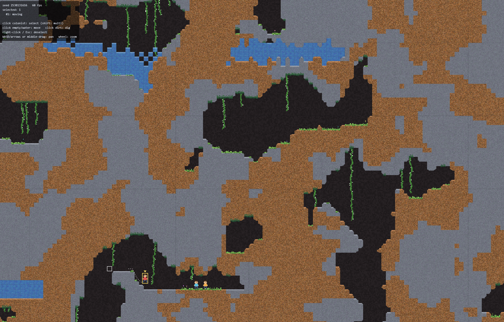

# Colony Sim

A browser-based colony simulation prototype with a 2D side-view tile platformer view. The world is a 200×200 tile grid of dirt, rock, water and open caves, overgrown with moss, grass, hanging vines and flowers. You directly control a small group of colonists: select them with the mouse, send them to a location, or order them to dig out dirt.

Built with TypeScript, Vite and the HTML5 Canvas 2D API. There is no game framework and no image assets; tiles, foliage and sprites are generated in code.



## Getting started

```sh
npm install
npm run dev       # start the dev server and open the game in your browser
npm test          # run the Vitest suite
npm run build     # type-check and build to dist/
npm run preview   # serve the production build
```

Each load generates a new random map. Add `?seed=<number>` to the URL (e.g. `http://localhost:5173/?seed=42`) to get the same map every time. The current seed is shown in the top-left HUD.

## Controls

| Input | Action |
| --- | --- |
| Left-click a colonist | Select it (replaces the current selection) |
| Shift + left-click a colonist | Add it to / remove it from the selection |
| Left-click an empty or water tile | Selected colonists move there |
| Left-click a dirt tile | Selected colonists go dig it out |
| Left-click a rock tile | Refused (the tile flashes red) |
| Right-click / Esc | Deselect all |
| WASD / arrow keys / middle-drag | Pan the camera |
| Mouse wheel | Zoom (anchored at the cursor) |

While colonists are selected, the hovered tile is outlined yellow (dig), red (can't dig) or white (move). Selected colonists show their planned path as a dotted line.

## Game rules

### Tiles

| Tile | Solid | Diggable | Affected by gravity |
| --- | --- | --- | --- |
| Empty | no | — | — |
| Dirt | yes | yes | no |
| Rock | yes | no | no |
| Water | no | — | yes |

Colonists can stand on dirt and rock. Water is passable: colonists walk and sink through it. The map edge acts as solid rock.

Each tile is drawn as a 32×32 procedural texture. Its colour noise is on a coarser 8×8 grid of cells, each covering 4×4 texels. Moss, grass and vines are drawn on the same cell grid, so they share the terrain's pixel size; flowers keep the full 32×32 detail.

| Tile | Base colour | Surface colour | Pixel noise (hue / saturation / brightness) |
| --- | --- | --- | --- |
| Dirt | rgb(137, 94, 58) | rgb(184, 129, 84) | 1% / 15% / 20% |
| Rock | rgb(111, 115, 126) | rgb(151, 156, 167) | 5% / 12% / 7% |
| Water | rgb(75, 134, 206) | rgb(127, 182, 238) | 2% / 5% / 3% |

The base colour is layer 20 and the noise is layer 21. When a tile has open space above it, its top 8 rows (a quarter of the tile, two rows of noise cells) use the surface colour and the noise there is drawn at 50% opacity. For dirt and rock, "open" means not solid, so water above still shows the surface. For water, it means an empty tile. The noise is hashed from the cell's position, so a tile looks the same every time it is redrawn.

Outer corners aren't sharp. A dirt or rock tile that is open on two adjacent sides (for example above and to the right) has that corner cut away on the cell grid, showing the cave wall behind. Both tile types use the same cut: a smooth staircase, 2–3 cells wide, shrinking by one cell every one or two rows.

Each corner reaches at most 4 cells along either edge, and a tile can have up to four cut corners. Shapes are hashed from the tile's position and randomly mirrored across the diagonal, so every corner is slightly different but stays the same when redrawn. Moss and grass skip the cut cells. The cuts are visual only: collision and pathfinding still treat the whole tile as solid.

Water fills the cut corners that face it, so pools don't show gaps at rounded edges. For each water tile, the cut cells on the water's side of these neighbours are drawn as water:
- the tiles to its left and right (their near corners);
- the tile below (its top corners);
- the tiles diagonally below-left and below-right (the top corner touching the water).

Water below or above a terrain tile's bottom corners never fills them.

### Foliage

Foliage is decoration only: it never affects pathfinding or movement. It lives in a second 200×200 array next to the terrain, holding one of: empty, floor moss, ceiling moss, hanging vine or grass. Flowers are kept in a separate list. Foliage is generated once, after the terrain, in these passes:

1. **Floor moss** grows on solid tiles that have an empty tile above:
   - rock: 15% chance, or 80% if there is water within 20 tiles;
   - dirt: always, if the tiles on both sides are dirt too.
2. **Ceiling moss** follows the same rules for solid tiles with an empty tile below. A one-tile-thick shelf qualifies for both; ceiling moss wins.
3. **Grass** grows in the empty tile above a floor-moss tile that has another floor-moss tile to its left or right.
4. **Hanging vines**: each ceiling-moss tile has a 20% chance of a vine. Its length is random, between 1 and the number of open tiles below it (empty in both arrays), up to 20.
5. **Background flowers**: 10% of grass tiles. They are 10–40% of a colonist's height, ±10%.
6. **Foreground flowers**: 10% of grass tiles, rolled independently. They are 30–55% of a colonist's height, ±15%, kept below a solid tile directly above.

Each foliage type is drawn in pixel art (a cell is 1/8 of a tile):

| Foliage | Look |
| --- | --- |
| Floor moss | Covers the top 1–2 cells of its tile, with tufts filling the bottom cell of the tile above. Its edge steps in runs 1–2 cells wide. |
| Ceiling moss | A dark, web-like net over the bottom 2–4 cells (20–50%) of its tile and 1–2 cells (10–20%) of the tile below, in runs 1–2 cells wide. |
| Grass | Blades one cell wide and up to 3 cells tall, in several greens, with moss-coloured roots. |
| Vines | A green stem 2–3 cells wide with white spike cells. They fade in from the ceiling-moss colour at the top. |
| Flowers | A stem, leaves on both sides (0–3 for background flowers, 1–5 for foreground) and a random petal colour. Background flowers have a darker centre, foreground flowers a lighter one. |

Grass wiggles briefly when a colonist enters or leaves it. Vines swing like a damped pendulum, pushed in the direction the colonist is moving.

Digging removes foliage that loses its support: moss on the dug tile, grass with no floor moss below it (and that grass's flowers), and vines whose ceiling moss is gone. Nothing regrows.

### Render layers

Layers are drawn in ascending order:

| Layer | Contents |
| --- | --- |
| 10 | Procedural cave wall, then background flowers (10–19 is the background range) |
| 20 | Terrain base colour |
| 21 | Terrain pixel noise |
| 22 | Grass |
| 23 | Hanging vines |
| 24 | Floor and ceiling moss |
| 25 | Colonists (and planned paths) |
| 26 | Water, drawn over colonists so they look submerged |
| 31 | Foreground flowers |

Layers 0–9, 11–19, 27–30 and 32–49 are free for future use. Selection, hover and dig markers are drawn on top of everything.

### Water

Water updates 5 times per second. Each water tile:

1. Falls 1 tile if the tile below is empty.
2. Stays put if the tile below is dirt or rock.
3. If the tile below is water, tries to move 1 tile left or right (random order) into an empty tile. This makes a connected body of water spread out and level into a flat surface.

Water ignores colonists, and the total amount of water never changes.

### Colonists

- 1×2 tiles in size. The collision box is slightly smaller (0.8 × 1.9) so they fit 1-wide shafts and 2-tall tunnels.
- Affected by gravity whenever there is no solid tile beneath them. They sink more slowly in water but otherwise move through it normally.
- Walk at 4 tiles/s. A jump peaks at about 2.3 tiles, enough to climb a 2-tile ledge or clear a 2-tile-wide gap.
- States:
  - **Idle**: standing still.
  - **Moving**: following a planned path to the clicked spot. If the spot can't be reached, the colonist goes as close as it can.
  - **Working**: standing next to a dirt tile and digging it. Digging takes 1.5 s and replaces the tile with empty space. Colonists can dig tiles beside them, just above their head, or directly under their feet.
- Whenever terrain changes (e.g. another colonist digs), moving colonists re-plan their route. A colonist that makes no progress for 3 s re-plans, and gives up after 4 retries.
- Colonists don't collide with each other.

### Pathfinding

The path graph's nodes are "foot tiles": a tile where a colonist's 2-tall body fits and there is a solid tile underneath. A* search uses these moves:

- **Walk** 1 tile left/right on the same level.
- **Step up** 1 or 2 tiles onto an adjacent ledge (needs headroom).
- **Drop** off a ledge to the first floor below.
- **Gap jump** 2–3 tiles horizontally (clearing a gap up to 2 wide), landing up to 2 tiles higher or lower, if the arc is clear.

## World generation

Maps are generated from a seed (`src/world/worldgen.ts`):

1. Fill the entire 200×200 map with dirt.
2. **Water pits.** Place four water rects, each 15–25 wide and 4–8 tall:
   - two centred about 50 tiles above the map center and two about 50 below (±3 tiles vertically);
   - in each pair, one is 15–35 tiles left of center and the other 15–35 tiles right, so they never overlap.

   Each pit is filled with the **edge jagging process** (`jagRect`): every tile along each edge is moved −1, 0 or +1 tiles along that edge's outward normal, so the outline is ragged.
3. **Dig caves.** Sample a Perlin noise field (3-octave fBm) and turn the top 20% of values into empty tiles, which carves cave-like pockets. Thresholding at the 80th percentile keeps the empty share at about 20% for every seed. Water tiles are left alone.
4. **Dirt to rock.** Sample a second, independent Perlin noise field over the remaining dirt tiles and turn the half above the median into rock.
5. **Spawn point.**
   - Open a 20×4 empty clearing at the center of the map (x 90–109, y 98–101), with its top, left and right edges jagged as in step 2.
   - Fill any gaps in the row beneath it with dirt so the colony has a floor.
   - Spawn 3 colonists side by side in the clearing.
   - Pick a random **dominant side**, left or right.
6. **Starting pond.** Place a 10×4 water rect 20–30 tiles beside the clearing on the dominant side, with its bottom row within 2 tiles of the spawn floor's height.

Water overwrites whatever was there. Once the simulation runs, it falls and spreads into nearby caves.

7. **Foliage.** Run the foliage passes described under [Foliage](#foliage).

## Project layout

| Path | Purpose |
| --- | --- |
| `index.html` | Page shell: full-window canvas and HUD |
| `src/main.ts` | Boot, fixed-timestep game loop (physics 60 Hz, water 5 Hz), HUD |
| `src/config.ts` | All tuning constants |
| `src/world/tiles.ts` | Tile types and the solidity rule |
| `src/world/World.ts` | Tile grid, change counters for terrain and water |
| `src/world/noise.ts` | Seeded 2D Perlin noise and fBm |
| `src/world/rng.ts` | Seeded PRNG (mulberry32) |
| `src/world/worldgen.ts` | The 7-step map generator and the edge jagging process |
| `src/world/foliage.ts` | Foliage array, spawn passes and removal after digging |
| `src/sim/water.ts` | Cellular water simulation |
| `src/sim/foliageAnim.ts` | Grass wiggle and vine swing when colonists pass |
| `src/sim/pathfinding.ts` | Path graph and A* search |
| `src/entities/Colonist.ts` | Colonist physics, state machine and path following |
| `src/game/Game.ts` | Game state: world, colonists, selection, commands |
| `src/input/Input.ts` | Mouse selection and commands, camera keys |
| `src/render/Camera.ts` | Pan/zoom and screen-to-world conversion |
| `src/render/Renderer.ts` | Runs the layer passes: chunk-cached terrain and moss, foliage, colonists, water, overlays |
| `src/render/layers.ts` | Render layer numbers |
| `src/render/tileArt.ts` | Procedural tile and wall textures, corner cuts (pure; no DOM) |
| `src/render/terrainEdges.ts` | Corner cuts per world tile, and which cut corners water fills (pure; no DOM) |
| `src/render/foliageArt.ts` | Pixel-art moss, grass, vine and flower generators (pure; no DOM) |
| `tests/` | Vitest tests for worldgen, edge jagging, foliage, tile and foliage art, animation, water, pathfinding, colonists and a full game run |

## Tuning

Gameplay numbers live in `src/config.ts`: world size, texels per tile, gravity, walk/air speed, jump height, fall speed in and out of water, dig time, stuck/retry limits and simulation tick rates. Generation parameters (empty fraction, clearing size, water pit and pond size and distance) are constants at the top of `src/world/worldgen.ts`. Foliage chances are at the top of `src/world/foliage.ts`, tile colours in `src/render/tileArt.ts`, and animation constants in `src/sim/foliageAnim.ts`.

### Rendering performance

Rather than one huge texture, the terrain and moss are baked in 16×16-tile chunks.
- Chunks are built only when they come into view.
- When tiles change, only the chunks around them are rebuilt. The old image stays on screen until the new one is ready, so nothing flickers.
- Chunks bake at 32, 16 or 8 texels per tile depending on zoom.
- The least recently drawn chunks are dropped once a memory budget is exceeded.

Water, grass, vines and foreground flowers are drawn each frame from cached sprites.

## Known limitations

- When a pool has a few extra tiles that don't fill a whole new layer, they keep sliding back and forth on the surface. This follows directly from the random left/right rule.
- Colonists ordered as a group all head for the same tile and overlap there.
- There is no fall damage, drowning or other colonist needs yet.
- Foliage never regrows. Tiles exposed by digging stay bare.
- The starting pond overwrites the terrain where it lands. If there is a cave below, it drains into it.
- The 8×16 colonist sprite is coarser than the 32-texel tiles.
